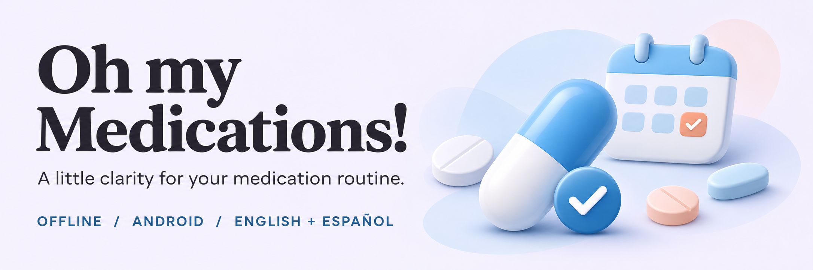
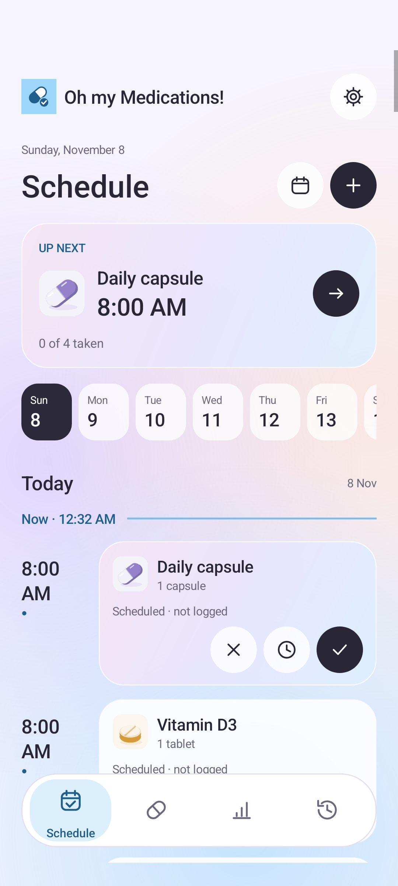
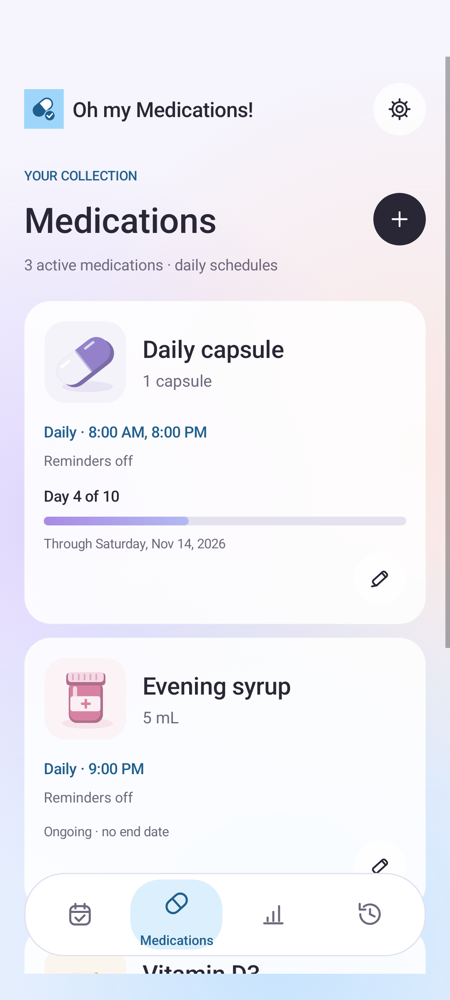
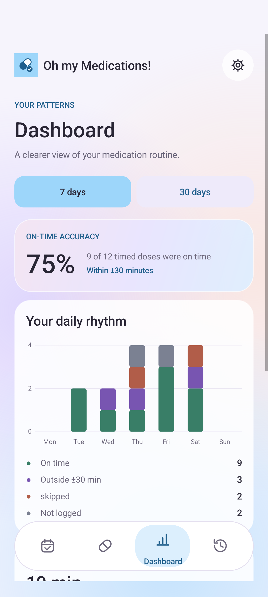
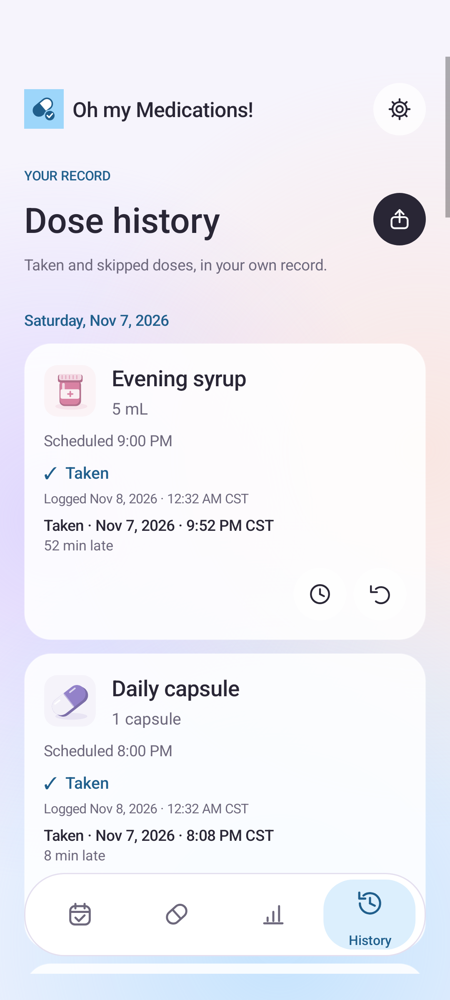

<p align="center">
  
</p>

# Oh my Medications!

A personal, offline Android medication tracker for daily schedules, ringing reminders, and a clearer record of when you took each dose.
Your medication data stays on your phone, with no account, ads, analytics, or internet permission.

**Android 8.0+ · Version 2.0 · English & Español**

**[Download the APK](https://github.com/ax9-labs/oh-my-medications/releases)** · [Features](#features) · [Screenshots](#screenshots) · [Get started](#get-started) · [Complete guide](docs/GUIDE.md)

## Screenshots

Captured from the current app on an Android 15 emulator with sample data.
Tap any screenshot to view it at full size.
The app starts empty on your phone.

<table>
  <tr>
    <th>Schedule</th>
    <th>Medications</th>
    <th>Dashboard</th>
    <th>History</th>
  </tr>
  <tr>
    <td><a href="docs/screenshots/schedule.png"></a></td>
    <td><a href="docs/screenshots/medications.png"></a></td>
    <td><a href="docs/screenshots/dashboard.png"></a></td>
    <td><a href="docs/screenshots/history.png"></a></td>
  </tr>
</table>

## Features

| Feature | What you can do |
| --- | --- |
| Daily schedule | Set 1-12 distinct times per medication, scroll through days, jump to a date, and see your next unlogged dose. |
| Treatment courses | Choose a start date and an optional 1-3650-day course, with calendar progress and reminders that respect the final day. |
| Dose logging | Mark doses taken or skipped, record the actual taken time, correct a timestamp, and undo accidental entries. |
| Timing dashboard | Review 7 or 30 days of on-time accuracy, average timing difference, and daily on-time, outside-window, skipped, and not-logged counts. |
| Ringing reminders | Use repeating alarm audio and vibration, a notification Stop action, and a lock-screen alarm view when Android permits it. |
| Medication library | Edit and archive medications, add instructions, and choose from six illustrated icons with eight optional colors. |
| History and CSV | Keep original medication details in past logs and export dose history through Android's file picker. |
| English and Spanish | Switch the app language, including forms, alarms, permission guidance, accessibility descriptions, and CSV labels. |
| Native interface | Navigate with four floating tabs, remembered scroll positions, accessible controls, and animations that respect Android's motion settings. |
| Offline storage | Keep records in an app-private SQLite database, without a login, network connection, or automatic Android backup. |

The dashboard treats a dose as on time when its actual taken time is within 30 minutes before or after its scheduled time.
Unknown actual times are excluded from timing accuracy.
An unlogged dose is not automatically classified as skipped.

## Get started

1. Open [GitHub Releases](https://github.com/ax9-labs/oh-my-medications/releases) and download **OhMyMedications.apk** from a build's assets.
2. Open the APK on your Android phone and allow installation from your browser or file manager if prompted.
3. Tap **+** and enter your medication name, prescribed dose, daily times, and optional instructions or treatment length.
4. Keep **Remind me at these times** enabled if you want alarms, and allow notifications when asked.
5. Open **Settings** to enable **Precise alarm settings** on Android 12+ and **Full-screen alarm settings** on Android 14+.
6. Use **Start a test alarm** and check your phone's alarm volume and Do Not Disturb settings.

**Install updates over your existing app without uninstalling to keep your data.**
Published APKs are development builds for personal testing, signed with the project's existing key.
They are not Google Play releases.

Stopping an alarm only silences it.
Use the check icon in **Schedule** after taking a dose, the clock icon to enter a different actual time, or **×** to record a skipped dose.
Android controls whether the alarm opens over the lock screen or appears as a notification.

See the [complete guide](docs/GUIDE.md) for permission troubleshooting, treatment rules, dashboard calculations, language settings, and upgrade behavior.

## Privacy and scope

The app has no internet permission and stores medication data locally.
Uninstalling the app or clearing its storage deletes those records.
CSV exports are history reports, not complete backups, and may contain health information.

Schedules are daily.
As-needed, weekly, interval-based, and tapering schedules, refill management, cloud sync, and CSV restore are not supported.
Alarms follow the phone's local time and depend on Android permissions and device settings.
Force-stopping the app disables pending alarms until it is reopened.

Follow your prescribed instructions.
The app records your choices; it does not calculate doses or advise whether to take a dose.

## Build and test

The app uses native Android views, Java, and SQLite, with no third-party runtime libraries.
Build scripts run the core Java tests and English/Spanish translation checks before creating a signed APK.

### Windows

Install Java 21, Python 3 with the `py` launcher, Android SDK Platform 35, and Build Tools 35.0.0.
Start an Android emulator, then run:

```powershell
.\build.ps1
adb -e install -r dist/med-tracker.apk
adb -e shell am start -n com.personal.medtracker/.MainActivity
```

### Linux

Install Java 21 with `keytool`, Python 3, `curl`, and the standard Linux libraries for Android build tools.

```sh
python3 setup-tools.py
chmod +x build.sh test.sh
./test.sh
./build.sh
```

Local builds produce `dist/med-tracker.apk`.
Keep the signing key stable so future builds can update existing installations.
Every push to `main` runs the [Android build and release workflow](.github/workflows/android-build.yml), which publishes an APK, checksums, and build metadata as a GitHub prerelease.

## Documentation

- [Complete guide](docs/GUIDE.md): detailed usage, permissions, scheduling behavior, signing, release setup, and disposable-emulator tests.
- [Design notes](docs/DESIGN.md): colors, navigation, native components, motion, and accessibility.
- [Localization](docs/LOCALIZATION.md): English/Spanish resources and adding languages.
- [Android permissions](docs/PERMISSIONS.md): alarm permissions and device behavior.
- [Verification](VERIFICATION.md): recorded Android integration and core test results.
